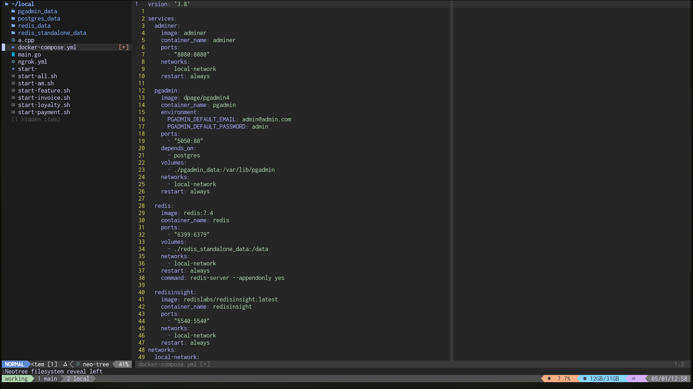

# dotfiles

My personal dotfiles for **zsh**, **tmux**, **Neovim**, and **iTerm2**, plus helper scripts for bootstrapping a new machine.

The macOS installer installs iTerm2 and creates a `Dotfiles` profile for each image in `bg/`. The profile using `02.png` is selected by default. Choose another image from iTerm2's Profiles menu to change the background.

